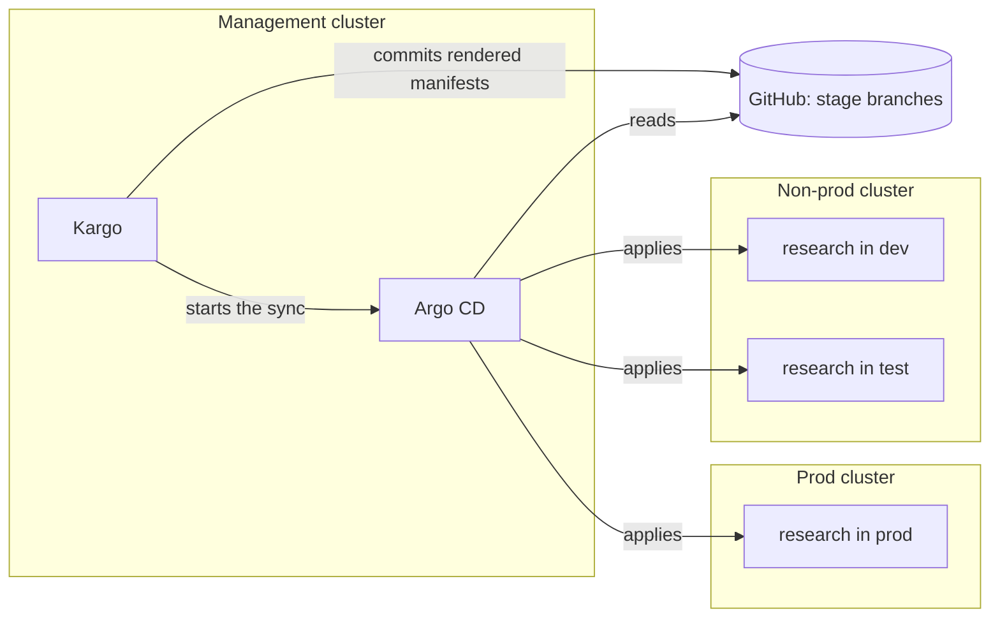
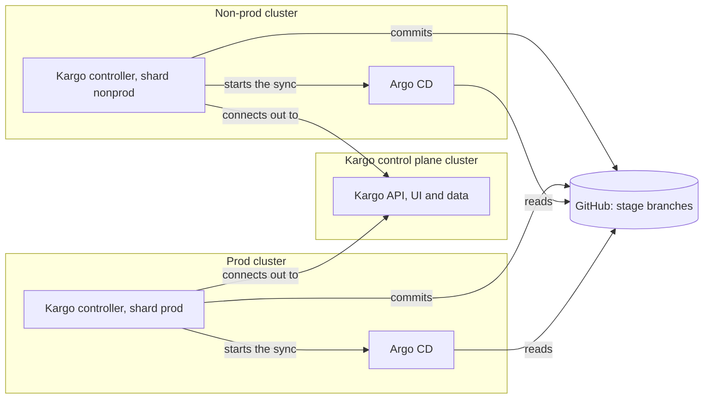

# Environments on separate clusters

The lab runs every environment on one kind cluster, with a namespace per agent
and stage (`research-dev`, `research-test`, `research-prod`). This document
describes how the same setup works when environments live on different
clusters. None of it is built or tested in this repo; it describes the change,
it does not make it.

## How teams usually split environments

| Layout | Typical use |
|---|---|
| One cluster, a namespace per environment | Labs, small teams, internal tools. This repo. |
| Two clusters: non-prod (dev and test as namespaces) and prod | The most common middle ground. |
| One cluster per environment | Larger or regulated organisations. |

The reasons to separate are mostly about prod:

- **Blast radius.** A bad upgrade of Kubernetes, the network layer or a shared
  component in dev cannot take prod down.
- **Access.** Developers can have broad rights on the dev cluster and almost
  none on prod.
- **Testing the platform itself.** A new Kubernetes version goes to dev first.
- **Sizing and network.** Prod often sits in its own subscription or network
  with stricter rules.

## The one thing to understand

Kargo never talks to the clusters the agents run on. A promotion does two
things: it commits rendered manifests to a git branch, and it tells Argo CD to
sync one Application. **Which cluster an environment lives on is decided by one
field of the Argo CD Application: its destination.**

So moving prod to another cluster changes the Argo CD side only. Warehouses,
Stages, the `promote-agent` recipe and the stage branches stay as they are. A
promotion of research to prod still commits to `stage/research/prod`; Argo CD
applies that commit somewhere else.

## Option 1: hub and spoke

One management cluster runs Argo CD and Kargo and deploys outward. This is the
simplest arrangement and the natural next step from this lab.



### What changes

**1. Register each workload cluster in Argo CD, once.**

```sh
argocd cluster add <kube-context-of-prod> --name prod
argocd cluster add <kube-context-of-nonprod> --name nonprod
```

This stores a credential for that cluster as a Secret in the `argocd`
namespace. From then on an Application can name it as a destination.

**2. Give every line of the ApplicationSet a cluster.** In `argocd/agents.yaml`:

```yaml
generators:
  - list:
      elements:
        - { agent: helpdesk, stage: dev,  cluster: nonprod }
        - { agent: helpdesk, stage: prod, cluster: prod }
        - { agent: research, stage: dev,  cluster: nonprod }
        - { agent: research, stage: test, cluster: nonprod }
        - { agent: research, stage: prod, cluster: prod }
template:
  spec:
    destination:
      name: "{{ .cluster }}"            # was: server: https://kubernetes.default.svc
      namespace: "{{ .agent }}-{{ .stage }}"
```

The Application names (`research-prod`) do not change, so the
`kargo.akuity.io/authorized-stage` annotation and the `argocd-update` step in
`kargo/shared.yaml` keep working untouched.

**3. Optionally simplify the namespaces.** With a cluster per environment the
stage no longer needs to be in the namespace name: `research-prod` on the
shared cluster can become `research` on the prod cluster. That is a change to
the `namespace:` line in each `agents/<name>/deploy/stages/<stage>/kustomization.yaml`
and to the destination namespace above.

**4. Review what differs per cluster in the stage overlays.** In the lab the
overlays only set a NodePort, `STAGE` and the replica count. On real clusters
this is where ingress host names, resource sizes and references to
cluster-specific secrets go. They are still per stage, so the folder layout
does not change.

### What does not change

| Piece | Why it is unaffected |
|---|---|
| `kargo/shared.yaml` (the promotion recipe) | It writes to git and names an Application. It has no notion of clusters. |
| `kargo/<agent>.yaml` (Project, Warehouse, Stages) | Stages order environments; they do not locate them. |
| Stage branches `stage/<agent>/<stage>` | Still one per agent and stage. |
| The release workflow and the images | Images are pulled by whichever cluster runs them. |
| The git token | Only Kargo uses it, and Kargo still runs in one place. |

### The trade-off

The management cluster holds credentials that can deploy to every cluster,
prod included. It has to be protected like prod, and access to its Argo CD is
access to everything.

## Option 2: Argo CD in every cluster

Each cluster runs its own Argo CD, which manages only itself. No credential
for prod exists outside prod.



Kargo must now reach several Argo CD instances. It does that by running a
Kargo **controller** next to each Argo CD. Each controller handles a subset of
the Stages, called a **shard**, and connects out to the central Kargo control
plane, which keeps all the data and serves the UI. The control plane needs no
access to the workload clusters. This is why `kubectl get stages` shows an
empty `SHARD` column in the lab: there is one controller and no shards.

What changes compared to option 1:

- Kargo is installed twice or more: the control plane once, and a controller
  per cluster, each configured with a shard name.
- Each Stage states its shard, so the right controller picks it up:
  ```yaml
  kind: Stage
  metadata:
    name: prod
    namespace: research
  spec:
    shard: prod
  ```
- The Applications are created in each cluster's own Argo CD, with the local
  destination (`https://kubernetes.default.svc`) again. One ApplicationSet per
  cluster, or one ApplicationSet file applied to each with a different list.
- The git token is needed by every controller, since each one pushes its own
  stage branches.

This is more to install and operate. Choose it when the rule "nothing outside
prod may hold prod credentials" matters more than simplicity. See the
architecture page of the Kargo operator guide for the installation details:
https://docs.kargo.io/operator-guide/architecture

## Which one

- Start with **option 1** and a non-prod and a prod cluster. It is a five-line
  change from this lab and shows the principle.
- Move to **option 2** when security or network rules forbid a central place
  that can reach prod, or when clusters sit behind different firewalls.

## Trying option 1 in this lab

The steps, should you want to see it work:

1. Create a second kind cluster, for example `kargo-prod`, with its own
   published ports for the prod agents.
2. Make it reachable from the first cluster. Both kind clusters are Docker
   containers on the same `kind` network, so the first cluster can reach the
   second's API server at `https://kargo-prod-control-plane:6443`; the
   kubeconfig used for `argocd cluster add` must use that address, not
   `127.0.0.1`.
3. `argocd cluster add` it under the name `prod`.
4. Add `cluster:` to the ApplicationSet as shown above, and apply it.
5. Promote to prod. The pods appear on the second cluster.
